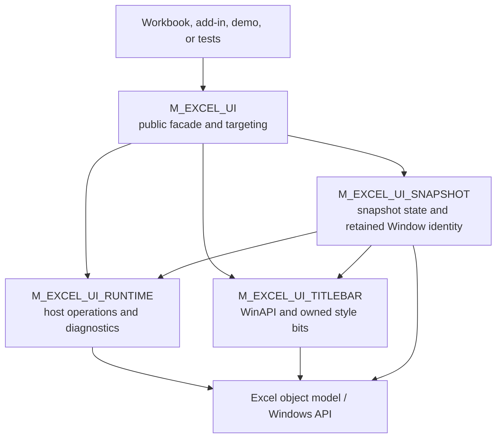

<div align="center">

# 🪟 VBA Excel UI

## A structured Windows Excel UI controller for application-style workbooks

**Tri-state visibility control · Targeted window scopes · Best-effort execution · Structured diagnostics · Identity-safe snapshot restore · Owned-bit title-bar management · Modular architecture**

<br>

[](https://github.com/danielep71/VBA-EXCEL_UI)
[](#requirements)
[](#public-api)
[](INSTALLATION.md)
[](#status)

<br>

[](https://github.com/danielep71/VBA-EXCEL_UI/releases)
[](LICENSE)
[](https://github.com/danielep71/VBA-EXCEL_UI/issues)

<br>

**No installer · No COM add-in · No third-party DLL · No non-standard VBA reference**

[Installation](INSTALLATION.md)
&nbsp;·&nbsp;
[Quick start](#quick-start)
&nbsp;·&nbsp;
[Public API](#public-api)
&nbsp;·&nbsp;
[Target scopes](#target-scopes)
&nbsp;·&nbsp;
[Architecture](#architecture)
&nbsp;·&nbsp;
[Regression tests](#regression-testing)
&nbsp;·&nbsp;
[Download demo release assets](https://github.com/danielep71/VBA-EXCEL_UI/releases)

---

<p align="center">
  
</p>

---

</div>

---

> [!IMPORTANT]
> This component ships as a **four-module production package**. Importing only
> `M_EXCEL_UI.bas` is not a valid installation. See [INSTALLATION.md](INSTALLATION.md).

> [!NOTE]
> The macro-enabled demo workbook is **not versioned in the repository**.
> Tested `.xlsm` demo builds are distributed only as GitHub Release assets.

## ✨ What this project is

**VBA Excel UI** is a focused VBA component for controlling the visible Excel shell on Windows.

It provides one stable project-facing API for:

- showing, hiding, or leaving unchanged individual Excel UI elements;
- applying application-level and window-level settings consistently;
- targeting all Excel windows, only the active window, or all windows of the active workbook;
- controlling the Excel title bar through bitness-safe WinAPI calls;
- capturing and restoring an in-memory UI baseline;
- restoring each captured Excel window by retained object identity rather than collection index;
- returning ordered structured diagnostics;
- maintaining a deterministic show-all emergency recovery path.

The public API remains concentrated in `M_EXCEL_UI`. Internal responsibilities are separated into private project modules for runtime services, snapshot state, and title-bar handling.

---

<a id="managed-ui-surface"></a>

## 🎚️ Managed UI surface

| UI element | Scope | Mechanism | Targetable |
|---|---|---|:---:|
| Ribbon | **Active window** | Ribbon command with best-effort state reads | No |
| Status Bar | Excel application | `Application.DisplayStatusBar` | No |
| Scroll Bars | Excel application | `Application.DisplayScrollBars` | No |
| Formula Bar | Excel application | `Application.DisplayFormulaBar` | No |
| Headings | Excel window | `Window.DisplayHeadings` | Yes |
| Workbook Tabs | Excel window | `Window.DisplayWorkbookTabs` | Yes |
| Gridlines | Excel window | `Window.DisplayGridlines` | Yes |
| Title Bar | **Active window** | Owned-bit WinAPI update on the captured window handle | No |

`TargetScope` applies only to Headings, Workbook Tabs, and Gridlines. Status Bar,
Scroll Bars and Formula Bar are genuinely application-level and affect the whole
Excel process.

The Ribbon and the title bar are **not** application-level, despite having no
window argument in their APIs. Modern Excel uses the Single Document Interface,
in which each workbook window is a separate top-level window with its own Ribbon
and its own frame. Both entries therefore act on whichever window is active when
the call is made.

For the title bar this is the intended contract, and the snapshot does retain
the Excel `Window` object it captured instead of restoring by collection index.
The v1.1.2 implementation does not yet prove the native side of that identity
strongly enough in every SDI recreation and handle-reuse case; see
[#45](https://github.com/danielep71/VBA-EXCEL_UI/issues/45) and
[#32](https://github.com/danielep71/VBA-EXCEL_UI/issues/32).

For the Ribbon it is a limitation rather than a guarantee. Every mechanism
Excel exposes acts on the active window and none accepts a window argument. In
v1.1.2, restoring a snapshot applies the captured Ribbon value to the window
that is active at that moment, which need not be the window it was captured
from. On `release/v1.1.3` (not yet released, and not in v1.1.2), restore fails
closed instead: when the captured window is not the active one, it reports a
Ribbon failure, writes nothing and activates no window. That correction is
certified on Excel 16.0 build 20430, 64-bit
([#23](https://github.com/danielep71/VBA-EXCEL_UI/issues/23)). Measurements
are in [docs/RIBBON_SDI_BEHAVIOR.md](docs/RIBBON_SDI_BEHAVIOR.md).

---

<p align="center">
  
</p>

---

<a id="quick-start"></a>

## ⚡ Quick start

> [!IMPORTANT]
> **Source compatibility is not package compatibility.** Every public `UI_...`
> procedure and enum member from `1.0.1` keeps its name, parameter order and
> defaults; `1.1.0` only added members (`UIWindowTargetScope`, an optional
> trailing `TargetScope` argument and the two snapshot `_WithResult`
> functions), so no call site needs editing. Upgrading nonetheless means
> replacing **all four** `src/` modules together: the internal boundaries
> between them changed at `1.1.0`, and a project holding a mixture of versions
> will not compile.

### 1. Import the complete production package

Import all four files from `src/`:

```text
src/M_EXCEL_UI_RUNTIME.bas
src/M_EXCEL_UI_TITLEBAR.bas
src/M_EXCEL_UI_SNAPSHOT.bas
src/M_EXCEL_UI.bas
```

Recommended dependency-first order:

```text
M_EXCEL_UI_RUNTIME
M_EXCEL_UI_TITLEBAR
M_EXCEL_UI_SNAPSHOT
M_EXCEL_UI
```

Then compile:

```text
VBA Editor → Debug → Compile VBAProject
```

For upgrade and troubleshooting instructions, see [INSTALLATION.md](INSTALLATION.md).

### 2. Apply selective UI control

```vb
UI_SetExcelUI _
    Ribbon:=UI_Hide, _
    StatusBar:=UI_Show, _
    ScrollBars:=UI_Hide, _
    FormulaBar:=UI_LeaveUnchanged, _
    Headings:=UI_Hide, _
    WorkbookTabs:=UI_Hide, _
    Gridlines:=UI_Hide, _
    TitleBar:=UI_Hide
```

Only explicitly requested elements are changed.

The default target scope remains all current Excel windows, preserving pre-v1.1.0 behavior.

### 3. Target a specific window scope

Only window-level elements are affected by `TargetScope`.

Active window only:

```vb
UI_SetExcelUI _
    Headings:=UI_Hide, _
    WorkbookTabs:=UI_Hide, _
    Gridlines:=UI_Hide, _
    TargetScope:=UI_TargetActiveWindow
```

All windows belonging to the active workbook:

```vb
UI_SetExcelUI _
    Headings:=UI_Show, _
    Gridlines:=UI_Show, _
    TargetScope:=UI_TargetActiveWorkbookWindows
```

Application-level elements still operate at their established scope even when a restricted target is selected.

### 4. Request structured diagnostics

```vb
Dim OK As Boolean
Dim FailureCount As Long
Dim FailureList As Variant
Dim i As Long

OK = UI_SetExcelUI_WithResult( _
        StatusBar:=UI_Show, _
        Headings:=UI_Hide, _
        Gridlines:=UI_Hide, _
        FailureCount:=FailureCount, _
        FailureList:=FailureList, _
        TargetScope:=UI_TargetActiveWindow)

If Not OK Then
    Debug.Print FailureCount & " failure(s)"

    If IsArray(FailureList) Then
        For i = LBound(FailureList) To UBound(FailureList)
            Debug.Print FailureList(i)
        Next i
    End If
End If
```

Failure entries use:

```text
Stage | Detail
```

Loop over the list's own bounds, not up to `FailureCount`. The list can hold
fewer entries than the count, and it can be `Empty` while the count is not; see
[Execution and diagnostics](#execution-and-diagnostics).

### 5. Hide or show the complete managed shell

```vb
UI_HideExcelUI
UI_ShowExcelUI
```

`UI_ShowExcelUI` means **show every managed element**. It does not restore a captured custom baseline.

### 6. Capture and restore a managed baseline

```vb
UI_CaptureExcelUIState
UI_HideExcelUI
UI_ResetExcelUIToSnapshot
```

Structured capture and reset:

```vb
Dim OK As Boolean
Dim FailureCount As Long
Dim FailureList As Variant

OK = UI_CaptureExcelUIState_WithResult( _
        FailureCount:=FailureCount, _
        FailureList:=FailureList)

OK = UI_ResetExcelUIToSnapshot_WithResult( _
        FailureCount:=FailureCount, _
        FailureList:=FailureList)
```

When the snapshot is no longer needed:

```vb
UI_ClearExcelUIStateSnapshot
```

Snapshot capture/restore retains its established all-managed-windows semantics. `TargetScope` applies to selective UI application, not to snapshot capture or restore.

---

<a id="public-api"></a>

## 🧩 Public API

> [!NOTE]
> The wiki carries a `wiki_tracks-vX.Y.Z` badge on every page, stating the
> release it was written against. During a release the wiki is re-badged before
> the tag is cut, so the badge is a release-candidate claim rather than proof
> the tag exists; `.github/workflows/wiki-badges.yml` checks that every page
> agrees with the root `VERSION` file.

> [!NOTE]
> This section is the supported surface. It is recorded declaration by
> declaration in the `[supported]` section of `tools/public_api_manifest.txt`
> and covered by Semantic Versioning, so a changed parameter, default, return
> type or enum value cannot reach a release without being declared. The
> `Public` helpers in the other three modules are visible only inside an
> `Option Private Module` project, are tracked in `[project-public]`, and carry
> no external compatibility promise. Neither is the deployment rule: all four
> `src/` modules are still replaced together.

### Public enums

```vb
Public Enum UIVisibility
    UI_LeaveUnchanged = -1
    UI_Hide = 0
    UI_Show = 1
End Enum
```

```vb
Public Enum UIWindowTargetScope
    UI_TargetAllExcelWindows = 0
    UI_TargetActiveWindow = 1
    UI_TargetActiveWorkbookWindows = 2
End Enum
```

### API reference

| Member | Type | Purpose | Diagnostic behavior |
|---|---|---|---|
| `UIVisibility` | Public enum | Show, hide, or leave unchanged | Not applicable |
| `UIWindowTargetScope` | Public enum | Select window-level target scope | Invalid values are controlled by the apply path |
| `UI_SetExcelUI` | Public `Sub` | Apply selective managed UI state | Logs failures |
| `UI_SetExcelUI_WithResult` | Public `Function` | Apply selective state with structured result | Boolean + count + optional list |
| `UI_HideExcelUI` | Public `Sub` | Hide all managed UI elements | Fail-soft; logs failures |
| `UI_ShowExcelUI` | Public `Sub` | Show all managed UI elements | Fail-soft; logs failures |
| `UI_CaptureExcelUIState` | Public `Sub` | Capture a managed baseline | Best effort; logs failures |
| `UI_CaptureExcelUIState_WithResult` | Public `Function` | Capture with ordered structured diagnostics | Boolean + count + optional list |
| `UI_ResetExcelUIToSnapshot` | Public `Sub` | Restore the current snapshot | Best effort; logs failures |
| `UI_ResetExcelUIToSnapshot_WithResult` | Public `Function` | Restore with ordered structured diagnostics | Boolean + count + optional list |
| `UI_HasExcelUIStateSnapshot` | Public `Function` | Report snapshot availability | Returns `Boolean` |
| `UI_ClearExcelUIStateSnapshot` | Public `Sub` | Discard snapshot state | No return value |

Window targeting, added in `1.1.0`, is backward compatible:

- existing public names are preserved;
- existing parameter order is preserved;
- `TargetScope` is optional and trailing;
- the default is `UI_TargetAllExcelWindows`;
- existing calls therefore keep their previous behavior.

---

<a id="target-scopes"></a>

## 🎯 Target scopes

`UIWindowTargetScope` controls only:

```text
Headings
Workbook Tabs
Gridlines
```

Supported values:

| Value | Meaning |
|---|---|
| `UI_TargetAllExcelWindows` | Apply to every current Excel window; compatibility default |
| `UI_TargetActiveWindow` | Apply only to `Application.ActiveWindow` |
| `UI_TargetActiveWorkbookWindows` | Apply to all windows in `ActiveWorkbook.Windows` |

`TargetScope` does not apply to the other elements. Status Bar, Scroll Bars and Formula Bar are application-level; the Ribbon and the title bar act on whichever window is active, as the managed UI surface table above shows.

An unsupported target value is handled through the established best-effort diagnostics contract. Valid application-level operations can still proceed, while window-level writes are suppressed when no safe scope can be resolved.

---

<a id="architecture"></a>

## 🏗️ Architecture



### Module responsibilities

| Module | Responsibility | Caller-facing API |
|---|---|---|
| `M_EXCEL_UI` | Public facade, enums, tri-state validation, target resolution, general apply orchestration | Yes |
| `M_EXCEL_UI_RUNTIME` | Shared diagnostics, result buffers, Ribbon/property helpers, quiet-update scope | No |
| `M_EXCEL_UI_SNAPSHOT` | Snapshot state, capture, restore, retained Window identity resolution | No |
| `M_EXCEL_UI_TITLEBAR` | WinAPI declarations, title-bar state, owned-bit merging and frame refresh | Internal test seam only |

All four modules use `Option Explicit` and `Option Private Module`.

### Dependency constraints

- `M_EXCEL_UI_RUNTIME` has no project-module dependency.
- `M_EXCEL_UI_TITLEBAR` has no project-module dependency.
- `M_EXCEL_UI_SNAPSHOT` depends on runtime and title-bar services.
- `M_EXCEL_UI` depends on all three internal modules.
- No circular dependency or duplicate mutable state is intended.

---

## 📸 Snapshot lifecycle and identity

The snapshot is stored in module memory and is lost after VBA reset, project unload, or Excel exit.

For each Excel window, the snapshot engine retains the exact captured `Window` object reference plus a diagnostic label. Restore never selects a target by `Application.Windows` collection index.

Expected behavior:

- window reordering does not redirect captured state;
- activation changes do not redirect captured state;
- a still-live captured window can be restored after its collection position changes;
- a newly opened window is left unchanged;
- a closed, recreated, or otherwise unusable captured window is reported as a best-effort failure;
- state is never intentionally applied to a different replacement window.

On `release/v1.1.3` (not yet released, and not in v1.1.2), the implementation
pairs the retained Excel `Window` with the native handle read from that same
object's `Window.hWnd`. Restore requires that the retained object still reports
the captured handle; a handle alone is never accepted as generation identity.
The proof for that branch is incomplete until
[#45](https://github.com/danielep71/VBA-EXCEL_UI/issues/45) and [#32](https://github.com/danielep71/VBA-EXCEL_UI/issues/32) close.

The Ribbon is also not identity-safe in v1.1.2. Its APIs act on the active
window and accept no window argument, so a snapshot restored while a different
window is active applies the captured Ribbon value to that window instead. On
`release/v1.1.3`, capture records the window the Ribbon was read from, and
restore writes the Ribbon only while that window is open and active.
Otherwise it reports a Ribbon failure, writes nothing and activates no window.
This fail-closed restore is certified on Excel 16.0 build 20430, 64-bit
([#23](https://github.com/danielep71/VBA-EXCEL_UI/issues/23)); see
[docs/RIBBON_SDI_BEHAVIOR.md](docs/RIBBON_SDI_BEHAVIOR.md).

Every captured element carries a `Known` flag recording whether its value was actually readable — the Ribbon, the title bar, the three application-level properties, and each window's Headings, Workbook Tabs and Gridlines. Capture continues after an element-level failure, and restoration never writes a value that was not successfully captured. A partial capture is therefore still a usable snapshot.

> [!CAUTION]
> Snapshot restoration is not persistent or transactional. It cannot survive a VBA project reset or guarantee rollback after Excel process termination.

> [!IMPORTANT]
> A snapshot retains a live `Window` reference per captured window, and restoring does not release them: the snapshot is deliberately kept so it can be replayed. Call `UI_ClearExcelUIStateSnapshot` when the baseline is no longer needed — `Workbook_BeforeClose` is the natural place. See [snapshot ownership](INSTALLATION.md#snapshot-lifetime-and-window-references).

---

## 🪟 Title-bar ownership

The title-bar subsystem owns only these `GWL_STYLE` bits:

- `WS_CAPTION`;
- `WS_SYSMENU`;
- `WS_THICKFRAME`;
- `WS_MINIMIZEBOX`;
- `WS_MAXIMIZEBOX`.

Showing the title bar merges the captured owned bits into the current style. It does not restore an entire historical style value, so unrelated style changes are preserved.

In v1.1.2, a show falls back to the safe visible frame only when the stored
baseline is all zero, so a non-zero baseline without a caption can still be
re-applied ([#6](https://github.com/danielep71/VBA-EXCEL_UI/issues/6)).

`WS_CAPTION` is the composite `WS_BORDER` | `WS_DLGFRAME`. A style that carries
only one of the two has a border or a dialog frame but no caption bar, so a
title bar is visible only when the complete mask is set:
`(style And WS_CAPTION) = WS_CAPTION`. On `release/v1.1.3` a stored baseline is
used for a show only when `HasBaseline` is true and the baseline carries the
complete mask. Every other baseline is unusable: none captured, all zero,
non-zero without a caption, and one with only `WS_BORDER` or only
`WS_DLGFRAME`. The show then merges the full owned frame into the current
style, keeping every unrelated bit. Every show, including a no-op, reads the
live style back and reports success only when the complete mask is set; a
missing caption returns `False` with a `TitleBar` diagnostic. The visibility
readers (`UI_TryGetTitleBarVisible` and the explicit-window reader) apply the
same test. This correction is not yet certified on Excel, and
[#6](https://github.com/danielep71/VBA-EXCEL_UI/issues/6) stays open until
`Test_EXCEL_UI_RunReleaseCertification` passes on the exact source. The bounded
negative control for the v1.1.2 condition passed under
[#66](https://github.com/danielep71/VBA-EXCEL_UI/issues/66): with that condition
restored, the regression fails instead of hanging.

Frame state is held per top-level window rather than once per process. In
v1.1.2 a slot was proved by its owned style bits alone, which was a partial
proof: a window that inherits a closed window's handle and carries the same
owned bits passes it. On `release/v1.1.3`, each hWnd slot also retains its
owning Excel `Window` object as a generation identity; equal style bits are
only a consistency check and cannot authenticate a recycled handle. The
regression keeps the numeric hWnd and changes only the window generation, with
equal-zero and equal-nonzero owned bits; [#32](https://github.com/danielep71/VBA-EXCEL_UI/issues/32) remains open until it passes on
Excel.
While the component does not own a hidden
state for a window, the live owned bits are re-read on every call, so a
legitimate frame change made by Excel or another add-in is adopted rather than
reverted on the next show.

A style write and its non-client frame refresh are treated as one unit of work.
If the style is written but Windows declines to repaint the frame, the
outstanding repaint is recorded against that window and retried before the next
call is allowed to conclude that there is nothing to do.

The WinAPI path remains Windows-only and best effort. The source contains VBA7
32-bit, VBA7 64-bit, and legacy 32-bit declaration arms. The supported host
requirement is VBA7 on 64-bit Office. The 32-bit arms are retained and
statically checked for compile integrity, but they are not runtime-certified.

---

<a id="execution-and-diagnostics"></a>

## 🛡️ Execution and diagnostics

The component deliberately uses best-effort processing:

1. a failure is recorded or logged;
2. later unrelated operations are still attempted;
3. `ScreenUpdating` is restored only where the component **confirmed** it
   changed it;
4. fire-and-forget APIs do not raise ordinary element-level failures.

On point 3, confirmed means read back. The quiet-update scope reads
`ScreenUpdating` on entry, writes only when it was enabled, then reads it again
and claims ownership only if that second read reports suppression. A write the
host refuses or silently ignores leaves the component owning nothing, so the
matching exit writes nothing.

A failed readback is different, and worth stating plainly. The write has already
happened by then, so redraw may well be suppressed — but the component cannot
prove it caused that, so it owns nothing and the matching exit restores nothing.
The host can therefore be left suppressed. No rollback is attempted, because a
rollback would be a second write this scope could not verify either, and that is
the behavior being removed. Release certification detects such a leftover: its
cleanup comparison reports `ScreenUpdating` changing from `True` to `False` as a
finding, before the regression case that causes it sets the host back
([What `cleanup=OK` covers](#what-cleanup-ok-covers)).

The `WithResult` APIs return:

| Output | Meaning |
|---|---|
| `True` | No failure was recorded |
| `False` | One or more failures were recorded |
| `FailureCount` | Number of failures |
| `FailureList` | Optional 1-based ordered string array |

Output buffers are cleared deterministically on entry.

`FailureCount` is authoritative and `FailureList` is best effort. When you pass
`FailureList`, read the two outputs together:

| `FailureCount` | `FailureList` | Meaning |
|---|---|---|
| `0` | `Empty` | No failure was recorded |
| Greater than `0` | `Empty` | The first entry could not be allocated, so no failure is listed |
| Greater than the number of entries | Array | The list is degraded or truncated |

When a later growth fails, the last existing entry is replaced with a
`Diagnostics | failure list could not be grown; …` marker, which needs no new
memory. A failed first allocation has no entry to replace, so the list stays
`Empty` and the count still reports every failure. Neither case guarantees any
diagnostic text when Excel runs out of memory; the count is the reliable signal.
When you omit `FailureList`, no list is built, so an `Empty` variable then says
nothing about allocation. Recording a failure never raises to the caller, because the accumulator runs inside error handlers
and a diagnostic that replaces the failure it was invoked to describe is worse
than no diagnostic at all.

---

<a id="regression-testing"></a>

## ✅ Regression testing

Optional test modules, imported together after the production modules:

```text
test/M_EXCEL_UI_TEST_HARNESS.bas         shared assertions, cleanup and evidence
test/M_EXCEL_UI_TEST_RUNTIME.bas         runtime cases
test/M_EXCEL_UI_TEST_SNAPSHOT.bas        snapshot cases and the Ribbon probe
test/M_EXCEL_UI_TEST_TITLEBAR.bas        title-bar cases
test/M_EXCEL_UI_TEST_CERTIFICATION.bas   release certification and the full pack
```

Public runners:

```vb
Test_EXCEL_UI_RunReleaseCertification     ' the release gate
Test_EXCEL_UI_RunAll                      ' interactive, not certification; opens and closes temporary windows
Test_EXCEL_UI_RunCore                     ' interactive, not certification
Test_EXCEL_UI_RunTitleBarOnly             ' interactive, not certification
Test_EXCEL_UI_RunSnapshotIdentity         ' a unit of the release gate; also runnable alone
Test_EXCEL_UI_RunTitleBarSdiIdentity      ' a unit of the release gate; destructive: opens and closes windows
Test_EXCEL_UI_RunRibbonSdiProbe           ' characterization, asserts nothing, not part of the gate
Test_EXCEL_UI_RunCertificationSelfTest    ' an isolated unit of the release gate; a failed certification must re-raise
Test_EXCEL_UI_RunOwnershipCleanupChecks   ' an isolated unit of the release gate; runner-owned snapshots are always released, and a forced cleanup failure, failed unit and inventory gap each fail certification
```

Only `Test_EXCEL_UI_RunReleaseCertification` is release certification. The
interactive runners stay usable for a quicker loop; they record no case
inventory and run neither the isolated units nor the identity units, so their
result never stands for a release.

To certify a release, run one command:

```text
Debug → Compile VBAProject
Test_EXCEL_UI_RunReleaseCertification
```

On Windows, `tools\Certify-EXCEL_UI.cmd` does the same from a clean checkout:
it builds a development workbook from the commit, compiles it, runs the
certification and collects the evidence in a folder bound to the commit
([docs/EXCEL_CERTIFICATION.md](docs/EXCEL_CERTIFICATION.md)).
`tools\Check-EXCEL_UI.cmd` runs that certification, then the runners above and
the demo checks, and writes one bundle with a log per runner and a
`summary.txt` ([docs/EXCEL_CHECKS.md](docs/EXCEL_CHECKS.md)).

It executes every mandatory unit, counts units, failures, skips and cleanup
separately, compares the host afterwards with a baseline of its entry state, and
emits a JSON document and a text report naming the exact Excel build the verdict
was obtained on:

```text
RESULT: PASS | COMPLETE | units=5 failed=0 skipped=0 cleanup=OK
```

Completeness and correctness are reported separately on purpose. A run that
skipped a mandatory unit is not a pass, whatever the assertions that did execute
reported. Neither is a run that could not record a unit, a skip or a cleanup
finding: it reports `FAIL | INCOMPLETE`, and both documents name the recording
failure.

The unit counters and the case inventory are separate parts of the verdict.
`units=5 failed=0 skipped=0` says how the units that were dispatched ended. It
does not say that the cases a release needs were present, unique and executed,
so certification also compares the cases it expected with the cases that ran
([What the case inventory covers](#what-the-case-inventory-covers)). A run in
which every assertion passed is `FAIL | INCOMPLETE` when that comparison finds a
difference, and a failed unit and an inexact inventory each make the outer call
raise, with the failure in the error it carries.

<a id="what-the-case-inventory-covers"></a>

### What the case inventory covers

[`tools/certification-manifest.json`](tools/certification-manifest.json) is the
release contract: the units, in the order a run executes them, and the
mandatory cases of each, named by the procedure that runs them. Version 1 lists
54 cases in five units. Two of them, `CertificationSelfTest` and
`OwnershipCleanupChecks`, are isolated units: each calls certification itself,
so each runs once before the live record opens, with no certification active,
and is recorded afterwards. Their nested runs cannot reach the accounting of the
run that executes them. The cleanup baseline is captured before they run, so
anything they leave changed is a cleanup finding named `isolated.<code>`, and the
entry window is made active again before the live units start.

Every other case runs through `TST_CertRunCase`, which records its start and
exactly one terminal status under its identifier. At the end of the run
certification stores the cases the manifest lists as expected and compares them
exactly with the cases that ran. Each difference is an inventory finding, named
`<code>:<case>`:

| Code | Reported when |
|---|---|
| `missing` | an expected case was never started, for example because an earlier case failed and its unit stopped |
| `noStart` | a case recorded a terminal status without a start |
| `duplicate` | a case started more than once, or recorded more statuses than starts |
| `noResult` | a case started and recorded fewer statuses than starts |
| `unexpected` | a case that the manifest does not list started or recorded a status |

A finding, or a comparison that did not run, makes the verdict
`FAIL | INCOMPLETE`. `certification.json` carries `manifestVersion`,
`inventory`, `inventoryDetail`, `expectedCases`, the ordered `caseResults` and
the `inventoryFindings`; `certification.txt` carries a `CASES` line with the
counts, an `EXPECTED` line for each expected case, a `CASE` line for each case
that started and an `INVENTORY` line for each finding.

The static gate holds the manifest, the registry in the certification module,
its dispatch and the `TST_CertRunCase` calls to each other, so a case cannot
be added, removed, duplicated or left out of a pack without a reviewed change
to the manifest. The manifest permanently lists the cases named in
[#42](https://github.com/danielep71/VBA-EXCEL_UI/issues/42), with one change of
name: #32 replaced `TST_Case_TitleBarSameStyleHandleReuse`, so the manifest names
`TST_Case_TitleBarSameHwndGenerationReuse`.

<a id="what-cleanup-ok-covers"></a>

### What `cleanup=OK` covers

Certification takes its own baseline of Excel before the first unit runs. It
keeps the baseline in a local variable and reads it without
`UI_CaptureExcelUIState`, so the cleanup check does not rest on the snapshot code
it checks. It retains every `Window` open on entry as an object, and it compares
windows by the handle each object reports, never with `Is`, because Excel
returns a new wrapper from every read of `Application.ActiveWindow`.

`cleanup=OK` means that everything in this table that could be read on entry was
read again on exit and matched:

| Compared with its entry value | Reported as a finding when |
|---|---|
| The EXCEL_UI snapshot slot | a snapshot is left behind, by a unit or at the end |
| `Workbooks.Count` and `Application.Windows.Count` | either differs |
| Each window open on entry | its retained `Window` no longer responds, reports another handle, or is missing from `Application.Windows` |
| Windows in `Application.Windows` | one is there that was not open on entry, even when the count matches |
| `DisplayStatusBar`, `DisplayScrollBars`, `DisplayFormulaBar`, `ScreenUpdating` | a value differs |
| `DisplayHeadings`, `DisplayWorkbookTabs`, `DisplayGridlines` of each entry window | a value differs |
| The title bar of each entry window, read from the frame handle that window reports | the caption mask (`WS_CAPTION` complete) or any owned frame bit differs |
| Frame refresh debt and component ownership of each entry window's frame, through the read-only registry seam | either differs |
| The active window | another window is active; I then activate the entry window again and report it if that fails |
| The Ribbon of the entry active window | the value differs, compared only while that window is active |

Every difference is one finding, with a stable code and both values, in the
order of the table. Findings are listed in `certification.json`
(`cleanupFindings`) and in `certification.txt` (`CLEANUP` lines), and any
finding makes the verdict `cleanup=FAILED`. A comparison that raises is a
finding too, and a finding the record cannot store makes the run
`FAIL | INCOMPLETE`. The error that `Test_EXCEL_UI_RunReleaseCertification`
raises for a failed run carries the verdict and every finding.

`cleanup=OK` does not cover what the documents list as unverified
(`cleanupUnverified` and `UNVERIFIED` lines), and it never treats an unverified
surface as clean:

- **The Ribbon of every other window.** The Ribbon is per window, and every
  mechanism that reads it acts on the active window and accepts no target. Only
  the Ribbon of the entry active window is compared, and only while that window
  is active on exit; otherwise the comparison is listed as not made. I do not
  claim that any other window's Ribbon was restored.
- **Frame-registry entries of windows opened and closed during the run.** The
  read-only seam answers for a handle, so it cannot enumerate them.
- **Any value that could not be read on entry** (a window property of a chart
  sheet, a handle that reads as zero), which is named when it is captured.
- **Everything the component does not manage**, such as `Calculation`,
  `EnableEvents`, `DisplayAlerts`, the status bar text or the selection.

`cleanupChecked` counts the comparisons that completed, and the validator
rejects `cleanup=OK` with none. `cleanup=OK` is a statement about this table on
the host that ran it, not a proof that no host state changed.

`Test_EXCEL_UI_RunAll` remains the interactive runner and is **not** the release
gate. It opens and closes temporary windows and workbooks for its targeting and
handle-reuse cases, but it does not run the snapshot-identity, SDI identity or
isolated units, it records no case inventory, and it produces no
machine-readable evidence.

The suite covers:

- tri-state behavior and wrappers;
- structured diagnostics;
- snapshot lifecycle and no-snapshot handling;
- retained-Window restoration and replacement-window non-interference for
  object-model window properties;
- title-bar owned-bit preservation and real WinAPI round-trips;
- active-window targeting;
- active-workbook-window targeting;
- invalid-target-scope diagnostics and application-level continuation;
- title-bar show recovery when no owned-bit baseline was captured;
- per-element application-level capture and idempotent restoration;
- title-bar restoration across two workbook windows, asserting both that the
  captured frame is restored and that the active frame is left untouched;
- a captured title-bar frame whose window has closed being reported rather than
  redirected;
- a Ribbon restore refused, with nothing written and no window activated, when
  another window is active or the captured window has closed
  (`TST_Case_RibbonRestoreRefusesOtherActiveWindow`,
  `TST_Case_RibbonRestoreRefusesClosedWindow`, on `release/v1.1.3`);
- a failed non-client frame refresh being recorded and retried instead of
  short-circuited as a no-op;
- failure accumulation degrading visibly instead of raising when an existing
  failure list cannot grow, and a failed first allocation leaving a counted
  failure with an `Empty` list (`TST_Case_FirstFailureAllocationKeepsContract`,
  on `release/v1.1.3`).

> [!IMPORTANT]
> Tests manipulate the real Excel UI of the current process. Run them in a controlled Excel instance.

---

## 🖼️ Demo and release assets

Version-controlled demo source:

```text
demo/M_EXCEL_UI_DEMO.bas
demo/M_DEMO_BUILDER.bas
demo/M_DEMO_CLEANUP_TESTS.bas
```

The macro-enabled demo workbook is intentionally **not committed to Git**.

A tested demo workbook is published as a GitHub Release asset, named for the tag it was built from:

```text
EXCEL_UI_DEMO_v<major>.<minor>.<patch>.xlsm
```

Releases v1.1.0, v1.1.1 and v1.1.2 each carry their workbook, and no other
attached asset. The most recent is `EXCEL_UI_DEMO_v1.1.2.xlsm` on
[v1.1.2](https://github.com/danielep71/VBA-EXCEL_UI/releases/tag/v1.1.2).

> [!NOTE]
> The demo workbook is not a behavioral reference. Its worksheet control
> wiring can lag the current demo source, and a rebuilt demo is scheduled for
> `1.2.0`; until then, the examples in this document are authoritative.

On `release/v1.1.3`, the Release workflow attaches the source archives
`VBA-EXCEL_UI-X.Y.Z.zip` and `VBA-EXCEL_UI-X.Y.Z.tar.gz` and their
`SHA256SUMS` to each new release. A workbook is built by hand, attached
afterwards and declared to `tools/release.py verify-published` with `--asset`.
[RELEASING.md](RELEASING.md) gives the steps for both.

Users who want a ready-to-run workbook should obtain it from the repository's **Releases** page rather than from the source tree.

---

## 🆘 Emergency recovery

Run:

```vb
UI_ShowExcelUI
```

This does not require an existing snapshot and is the preferred recovery command after interrupted development, missing snapshot state, or a VBA reset.

---

## 📦 Repository structure

[docs/REPOSITORY_STRUCTURE.md](docs/REPOSITORY_STRUCTURE.md) lists the files and
directories of the repository and what each holds. The source repository
intentionally contains no versioned demo `.xlsm`; release binaries are attached
to tagged GitHub Releases.

## Documentation map

| Document | Purpose |
|---|---|
| [INSTALLATION.md](INSTALLATION.md) | Fresh install, upgrade, required modules, targeting, validation, troubleshooting |
| [README.md](README.md) | Project overview, API, architecture, behavior, limitations |
| [CONTRIBUTING.md](CONTRIBUTING.md) | Contributor workflow: branches, commits, validation, evidence and pull requests |
| [CHANGELOG.md](CHANGELOG.md) | Release history |
| [RELEASING.md](RELEASING.md) | Release preparation, certification, evidence and publication |
| [SECURITY.md](SECURITY.md) | Security reporting and safe-use boundaries |
| [CODE_OF_CONDUCT.md](CODE_OF_CONDUCT.md) | Expected conduct and how it is enforced |
| [AGENTS.md](AGENTS.md) | Instructions for automated coding assistants working in this repository |
| [docs/VBA_HOUSE_STYLE.md](docs/VBA_HOUSE_STYLE.md) | Rules for the VBA source: exported-source rules, formatter, analyzer, WinAPI error capture, syntax rules, public contracts and Excel state ownership |
| [docs/GOVERNANCE.md](docs/GOVERNANCE.md) | Base branch, rulesets, pull requests and review threads, repository settings, pinned Actions and Dependabot |
| [docs/REPOSITORY_STRUCTURE.md](docs/REPOSITORY_STRUCTURE.md) | The file tree and what each directory holds |
| [docs/ISSUE_LABELS.md](docs/ISSUE_LABELS.md) | Issue labels, priorities, milestones, target dates and the issue workflows |
| [docs/WORKBOOK_SYNC.md](docs/WORKBOOK_SYNC.md) | Importing the modules into a workbook from the command line, and checking a workbook's VBA against a commit |
| [docs/EXCEL_CERTIFICATION.md](docs/EXCEL_CERTIFICATION.md) | One-command release certification in Excel and its evidence folder |
| [docs/EXCEL_CHECKS.md](docs/EXCEL_CHECKS.md) | Certification, the regression runners and the demo checks in one command, with a log per runner and a summary |
| [docs/VBA_CALL_CHECKER.md](docs/VBA_CALL_CHECKER.md) | The advisory check of calls across modules |
| [docs/RIBBON_SDI_BEHAVIOR.md](docs/RIBBON_SDI_BEHAVIOR.md) | Measured Ribbon behaviour across workbook windows, and the model it commits the component to |
| [Regression tests](test/) | Behavioral verification: the harness and one module per suite |
| [GitHub Releases](https://github.com/danielep71/VBA-EXCEL_UI/releases) | Release notes and tested demo workbooks; [RELEASING.md](RELEASING.md) lists the assets a release carries |

---

<a id="requirements"></a>

## 💻 Requirements

- Microsoft Excel desktop for Windows;
- a macro-enabled workbook or add-in host;
- VBA project access for importing `.bas` modules;
- VBA7;
- 64-bit Office, the only bitness on which I certify releases. I have no
  32-bit host: the 32-bit WinAPI declarations are kept and checked statically,
  but 32-bit Office is not certified
  ([#51](https://github.com/danielep71/VBA-EXCEL_UI/issues/51));
- host policy permitting the required WinAPI calls.

Unsupported:

- Excel for macOS;
- Excel for the web;
- non-Excel VBA hosts;
- environments that block required WinAPI calls.

No third-party DLL, COM component, package manager, or non-standard VBA reference is required.

---

## 🔍 Scope and limitations

- **Windows only.** Title-bar control depends on WinAPI.
- **Current Excel instance.** Application-level properties affect the running Excel process.
- **Targeted window operations.** Headings, Workbook Tabs, and Gridlines support all windows, active window, or active-workbook windows.
- **Retained identity, in memory only.** Window identity is retained by object reference; on `release/v1.1.3` the title bar also pairs that object with its `Window.hWnd`. Snapshots do not survive VBA reset or Excel restart.
- **Changed window set after capture.** New windows are unchanged; missing captured windows produce diagnostics.
- **Ribbon restoration is not window-identity-safe.** Every Ribbon mechanism acts on the active window and accepts no window argument. In v1.1.2, a snapshot restored while a different window is active applies the captured value to that window. On `release/v1.1.3`, that restore fails closed instead: it reports a Ribbon failure and writes nothing ([#23](https://github.com/danielep71/VBA-EXCEL_UI/issues/23)). Restoring the Ribbon to its captured window by activating it is [#44](https://github.com/danielep71/VBA-EXCEL_UI/issues/44). See [docs/RIBBON_SDI_BEHAVIOR.md](docs/RIBBON_SDI_BEHAVIOR.md).
- **Native frame corrections are incomplete.** `release/v1.1.3` carries partial
  corrections for [#32](https://github.com/danielep71/VBA-EXCEL_UI/issues/32), [#45](https://github.com/danielep71/VBA-EXCEL_UI/issues/45) and [#6](https://github.com/danielep71/VBA-EXCEL_UI/issues/6). All three are still
  open, and none of them is a release claim until the exact source passes the
  Excel regression and release gates; see the release boundaries in
  [INSTALLATION.md](INSTALLATION.md).
- **Best-effort Ribbon and frame behavior.** Excel, Windows, add-ins, and window mode can affect visible results.
- **No durable transaction.** Process termination can prevent restoration.
- **Not a security boundary.** Hidden Excel UI does not prevent other code or informed users from changing state.
- **Binary demo not source-controlled.** The ready-to-run `.xlsm` is a release asset, not part of the repository tree.

---

## 🧭 Release status

### v1.1.2 — correctness release

Addresses three findings of an independent review of `v1.1.1`, cited by their
`ICR-UI-111-*` identifiers, together with four defects found during the
release. The public API is
unchanged: no procedure, enum or parameter was added, removed or renamed, and no
existing call site requires modification.

Every item is a mechanism that reported success, or the wrong failure, over work
it had not done:

- claimed frame state is discarded when the live owned bits contradict the
  component's last write; post-release review showed that a recycled handle
  with the **same** owned bits can still collide, so #32 is reopened;
- release certification no longer destroys the error it re-raises, so a failed
  run reaches its caller instead of returning silently;
- cleanup judged against the state a run started from, rather than requiring a
  fixed value it was never entitled to assume;
- a runtime-error diagnostic that read `Err` after suppressing errors, and
  described nothing;
- a house-style formatter that rewrote text inside string literals, changing
  what a module printed rather than how it was laid out;
- two title-bar regression cases that had never run under release certification,
  including the one written for this release's own frame-state fix;
- a certification self-test that replaced a caller's snapshot and then
  discarded it, now refused while a snapshot exists
  ([#43](https://github.com/danielep71/VBA-EXCEL_UI/issues/43)).

> [!NOTE]
> **Erratum, 2026-11-15
> ([#48](https://github.com/danielep71/VBA-EXCEL_UI/issues/48)).** Two of the
> v1.1.2 corrections above were incomplete. The frame registry still lets a
> recycled handle with the same owned bits reuse stale state; style equality
> is a consistency check, not proof of identity, and
> [#32](https://github.com/danielep71/VBA-EXCEL_UI/issues/32) is open. The
> v1.1.2 self-test refused a caller's snapshot, but its unconditional cleanup
> still cleared that snapshot; `release/v1.1.3` corrects this under
> [#43](https://github.com/danielep71/VBA-EXCEL_UI/issues/43) at
> `32baef384ee306082483ea5dcaf40abfe3224118`. The erratum to v1.1.2 and the
> review finding crosswalk in [CHANGELOG.md](CHANGELOG.md) give the current
> state of every finding.

### v1.1.1 — corrective release

Addresses the findings of an independent review of `v1.1.0`, cited by their
`ICR-UI-*` identifiers.
The public API is unchanged: no procedure, enum or parameter was added, removed
or renamed, and no existing call site requires modification.

- title-bar snapshot restoration moved from collection-index targeting to a
  retained `Window` object; `release/v1.1.3` pairs that object with its own
  native hWnd, and the proof of that pairing remains open under
  [#45](https://github.com/danielep71/VBA-EXCEL_UI/issues/45);
- title-bar frame state keyed per window rather than once per process, and the
  baseline re-read while the component does not own a hidden state;
- a failed non-client frame refresh recorded and retried rather than
  short-circuited as a false no-op;
- failure accumulation made incapable of raising from inside an error handler;
- a single release-certification runner with counters, cleanup verification and
  machine-readable evidence;
- Ribbon behaviour under the Single Document Interface measured and documented.

### v1.1.0 — feature release

- identity-safe per-window snapshot restoration;
- owned-bit title-bar restoration;
- structured snapshot capture and restore results;
- internal four-module decomposition;
- installation and dependency documentation;
- additional public window-targeting scopes;
- active-window and active-workbook-window regression coverage;
- invalid-target-scope structured diagnostics.

### Known limitations carried forward

- Ribbon restoration is not window-identity-safe. On `release/v1.1.3` a
  restore to a window other than the active one fails closed instead of
  writing to the wrong window; see
  [docs/RIBBON_SDI_BEHAVIOR.md](docs/RIBBON_SDI_BEHAVIOR.md).
- Ribbon behaviour has been measured on two 64-bit hosts, Excel 16.0 builds
  20131 and 20430. It can vary by Office channel, update ring and
  administrative policy, and 32-bit Office is not measured.

---

<a id="status"></a>

## 📌 Status

Stable. Every public `UI_...` procedure and enum member established in `1.0.1`
is preserved through `1.1.2`. `1.1.0` added backward-compatible window
targeting and structured snapshot results to that surface, alongside
object-identity snapshots, per-window title-bar ownership and a four-module
internal architecture. The current v1.1.2
runtime and assurance boundaries are tracked in
[INSTALLATION.md](INSTALLATION.md#current-release-boundaries).

Upgrading from `1.1.0` requires no source change. Two behaviours are newly
observable and are described in
[CHANGELOG.md](CHANGELOG.md): a `TitleBar` failure can now be reported where the
previous build silently applied a captured value to whichever window was active,
and `FailureList` may hold fewer entries than `FailureCount` under memory
pressure. An existing list can record a `Diagnostics` truncation marker; a
failed first allocation leaves the list `Empty` while `FailureCount` still
counts the failure.

---

## 👤 Author

**Daniele Penza**

## 📄 License

Licensed under the [MIT License](LICENSE).
